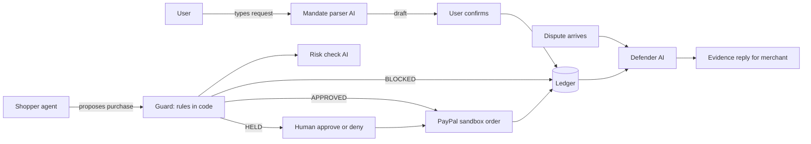

# Mandate Architecture

**One line:** Agents can spend safely. Merchants can prove it.

## System Flow

## Key Design Principles

1. **Never trust the caller:** The Shopper Agent only proposes a `product_id`. `app/guard.py` loads the authoritative price and seller directly from `data/catalog.json` via `app/catalog.py`.
2. **Rules are code, AI is only for fuzzy judgment:** Hard caps, allowlists, expiry, keyword matching, and kill switches live in deterministic Python code. Gemini AI is used only for natural-language mandate parsing, seller risk hints, product picking, and drafting dispute replies.
3. **Tamper-evident, not tamper-proof:** Every ledger row chains to the previous SHA-256 hash. Any single-row edit breaks verification at that exact `seq`. Someone with full SQLite database access could recompute the entire chain from `GENESIS`; a production deployment would anchor `head_hash` externally or apply cryptographic signatures.
4. **User confirmation, not cryptographic signing:** Mandates are explicitly **confirmed by the user** (`confirmed_at`) rather than cryptographically signed.

## Module Breakdown

| Module | Responsibility |
|---|---|
| [`app/config.py`](../app/config.py) | Loads `.env` switches (`LLM_MODE`, `PAYPAL_MODE`, `DEV_MODE`), enforces `PAYPAL_BASE_URL == https://api-m.sandbox.paypal.com` on startup, hides secrets from `/api/config`. |
| [`app/db.py`](../app/db.py) | Creates all 6 SQLite tables on startup, manages transactions, and stores the global `kill_switch`. |
| [`app/ledger.py`](../app/ledger.py) | Append-only SHA-256 hash chain (`GENESIS` -> entry hashes), `verify()` walker, and `DEV_MODE`-only `dev_tamper_entry()` demo helper. |
| [`app/llm.py`](../app/llm.py) | Single Gemini (`google-genai`) wrapper with Pydantic `response_schema`, 1 retry + mock fallback, all 4 prompt templates, and deterministic mock implementations. |
| [`app/mandate.py`](../app/mandate.py) | Converts text to editable drafts (recording omitted defaults in `assumptions`), validates caps, confirms mandates, and writes `MANDATE_CONFIRMED`. |
| [`app/catalog.py`](../app/catalog.py) | Loads authoritative product prices and seller metadata (`verified`, `domain_age_days`) from [`data/catalog.json`](../data/catalog.json). |
| [`app/risk.py`](../app/risk.py) | Deterministic seller-risk heuristic (+0.30 new domain, +0.25 low price, +0.15 urgency/injection phrases, +0.15 unverified) + live Gemini score (`max(heuristic, ai)`). |
| [`app/guard.py`](../app/guard.py) | Evaluates all 8 checks against catalog truth, enforces precedence & cost rules, records `PURCHASE_DECIDED`, and resolves human-in-the-loop holds (`HUMAN_RESOLVED`). |
| [`app/agent.py`](../app/agent.py) | Picks a single `product_id` (normal safe mode vs. intentionally gullible injection demo + safe comparison) and hands it to the Guard. |
| [`app/paypal.py`](../app/paypal.py) | PayPal Sandbox OAuth2 token cache, Orders v2 create (`PayPal-Request-Id` idempotency, `experience_context`), capture, Disputes v1 read, plus mock-mode simulation. |
| [`app/defender.py`](../app/defender.py) | Builds dispute evidence packets strictly from ledger events, rates strength (`STRONG`/`WEAK`/`NO_RECORD`), drafts replies, and runs a factual post-check. |
| [`app/main.py`](../app/main.py) | FastAPI application serving REST endpoints, PayPal return/cancel callbacks, and the static web UI. |
| [`static/`](../static/index.html) | Framework-free responsive HTML/CSS/JS UI with light/dark mode, 4 tabs (`Shop`, `Approvals`, `Merchant`, `Ledger`), and 2s activity polling. |
| [`scripts/run_eval.py`](../scripts/run_eval.py) | Runs the 24 scripted evaluation cases in [`tests/eval_cases.json`](../tests/eval_cases.json) and writes [`docs/EVAL.md`](EVAL.md). |

## Data Model (SQLite: `mandate.db`)

- `mandates`: `id`, `raw_text`, `item_keywords` (JSON), `max_item_usd`, `max_day_usd`, `allowed_sellers` (JSON), `expires_at`, `confirmed_at`, `status` (`active|revoked`), `assumptions` (JSON).
- `attempts`: `id`, `mandate_id`, `product_id`, `seller`, `price_usd`, `decision` (`APPROVED|BLOCKED|HELD`), `reason_codes` (JSON), `checks` (JSON), `risk_score`, `risk_reasons` (JSON), `human_resolution` (`approved|denied|null`), `status` (`decided|order_created|paid|denied`), `created_at`.
- `orders`: `id`, `attempt_id`, `paypal_order_id`, `capture_id`, `status`, `amount_usd`, `source` (`sandbox|mock`), `approval_url`, `created_at`.
- `disputes`: `id`, `order_id`, `paypal_dispute_id`, `claim`, `source` (`paypal|simulated`), `evidence` (JSON), `strength` (`STRONG|WEAK|NO_RECORD`), `draft_reply`, `created_at`.
- `settings`: `key`, `value` (holds `kill_switch`).
- `ledger`: `seq` (autoincrement), `type`, `ref_id`, `body_json`, `prev_hash`, `hash`, `ts`.

### Hash Chain Formula
- First entry: `prev_hash = "GENESIS"`
- Subsequent entries: `prev_hash` equals the preceding row's `hash`
- `hash = sha256(prev_hash + canonical_json({"body": body, "ref_id": ref_id, "ts": ts, "type": type}))` where `canonical_json` uses sorted keys and compact separators (`(",", ":")`).

## Guard Decision Table

| Reason Code | Deterministic Check | Result if Failed |
|---|---|---|
| `KILL_SWITCH` | Global `kill_switch` is off | `BLOCKED` |
| `MANDATE_INACTIVE` | Mandate exists, has `confirmed_at`, and `status == 'active'` | `BLOCKED` |
| `MANDATE_EXPIRED` | `now < expires_at` | `BLOCKED` |
| `OVER_ITEM_CAP` | Catalog `price_usd <= max_item_usd` | `BLOCKED` |
| `OVER_DAY_CAP` | Today's UTC approved + human-approved total + `price_usd <= max_day_usd` | `BLOCKED` |
| `ITEM_MISMATCH` | Every mandate keyword appears in product title or tags (case-insensitive) | `BLOCKED` |
| `UNKNOWN_SELLER` | Catalog `seller` is in `allowed_sellers` | `HELD` |
| `HIGH_RISK` | `risk_score < RISK_THRESHOLD` (default `0.7`) | `HELD` |

- **Precedence:** Any `BLOCKED` reason -> `BLOCKED`; else any `HELD` reason -> `HELD`; else `APPROVED`.
- **Cost rule:** If any `BLOCKED` rule fails, the AI risk check is **skipped** (recorded in `checks`) so we never spend LLM calls on already-blocked purchases.
